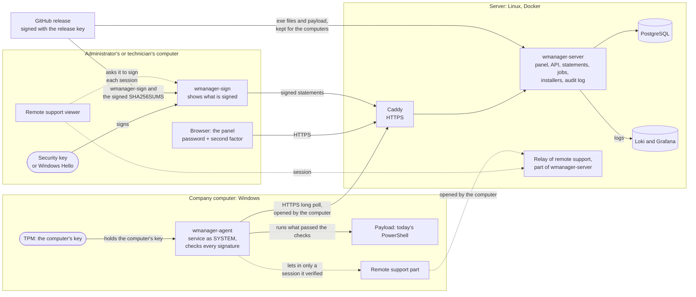
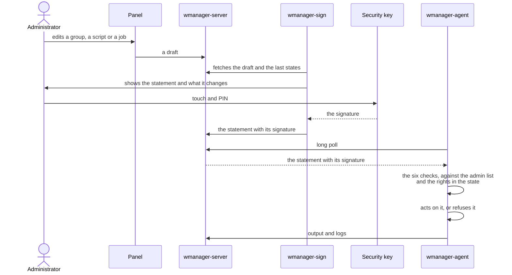

# Architecture of wmanager v1: server and agent

> **Status: a design for review. Nothing in it is built yet.** wmanager today works as the other documents describe.
> This document is the plan for v1 and the releases after it; the stages and what each release brings are in the
> [Implementation plan](implementation.md). The requirements it must meet are in [Requirements of v1](requirements.md);
> those marked "to design" there are not covered here yet.

wmanager today needs no server. A person provisions a computer from a USB drive or with the one-liner. After that the
computer pulls a signed management source (a Git repository, a web server or a share). It runs only what that
source's key has signed.

In v1 a server is required, and four things come with it:

- a sign-in to the panel with a mandatory second factor;
- the agent installer, made by the server for each company;
- updates of the agent and of wmanager itself, without visiting the computers;
- single jobs on one computer or a group, with the output in the panel.

One property must survive the move: **the server alone cannot make a computer run anything.** Every script, package
list, setting, secret value, wmanager version and single job that a computer acts on is signed by an administrator
of that company, or by a person the company's signed state gives that right. The signer, `wmanager-sign`, is a
program on that person's own computer, not the panel. A hacked server can
read and withhold, but it can't make an enrolled computer run code. A new computer is safe only when its installer
is checked (see [What a hacked server can and can't do](#what-a-hacked-server-can-and-cant-do)).

## What stays the same

- **What runs on the computer:** the provisioning steps (debloat, privacy, accounts, Chocolatey, backup and
  `Restore-Backup.ps1`), groups, packages, scripts, jobs, the startup, fixed-time, event and sign-in triggers, run-as
  user, secrets masked in the output, and the library. This is the PowerShell code of today, run by the agent in
  Windows PowerShell 5.1.
- **The scheduled tasks** (`wmanager-Update`, `-Jobs`, `-Logon`, `-Startup`, `-Event-*`, `-Notify`) stay in v1. The
  agent replaces how a computer *gets* its content, and adds what needs a live connection.
- **A person at the computer for provisioning.** The installer runs in a console and asks for the computer name and the
  passwords typed at the computer, as `run.cmd` does today.
- **The ten languages**, on the computer, in the panel and in `wmanager-sign`.
- **Loki and Grafana**, and the self-hosting kit in `examples/selfhosted/`.

## Parts



The administrator works in the panel, and signs in `wmanager-sign` with a security key or Windows Hello. The server
keeps everything and hands it out, but the agent acts only on what passes its checks against the company's admin
list and the rights in its signed state, so a hacked server can't make an enrolled computer run anything. The
computer opens every connection itself: nothing listens on it, remote support included. The dashed lines are remote
support and remote work, which come in v2 (requirements 42 and 43).

| Part | What it is |
| --- | --- |
| `wmanager-server` | One Go program in a Docker image, with PostgreSQL. It serves the panel (HTML rendered on the server, with a small JavaScript file for passkeys and no build step) and the API for agents and for `wmanager-sign`. |
| `wmanager-agent` | One Go program for Windows. Started by hand it is the installer; after that it runs as the `wmanager` service as SYSTEM. It lives in `C:\Program Files\wmanager`, and its data stays in `C:\ProgramData\wmanager` with today's protection (SYSTEM and Administrators only). |
| the payload | Today's PowerShell code (`Provision.ps1`, `lib\`, `lang\`, `Invoke-*.ps1`), released as the ZIP it is today. |
| `wmanager-sign` | One Go program for the computer of an administrator or of a person with rights, on Linux and Windows first. It shows what is to be signed and signs it with that person's security key or Windows Hello. |
| remote support | Our fork of RustDesk (Rust): a part on the computer, set up by the agent, and the technician's viewer, which asks `wmanager-sign` to sign each session (see [Remote support](#remote-support)). Employees use the same viewer for [remote work](#remote-work). |

All of them come from the same release and the same repository (`server/`, `agent/`, `sign/`, with the PowerShell
code where it is now; where the fork of RustDesk lives is to design).

### A change, from the panel to the computer



The panel only prepares a draft. What is signed is what `wmanager-sign` shows, and what the computer acts on is what
it has checked itself. The server stands between them, so it can delay or withhold a statement, but it can't change
one without breaking its signature.

## Several companies on one server

One server holds many companies, and each is kept apart:

- **What is the company's own:** its administrators and admin list (so its fingerprint), computers, groups, files,
  settings, secrets, single jobs, installers and audit log. Every row in the database belongs to one company, and
  every query of the panel and the API is limited to the companies of the signed-in account.
- **The computers stay apart too.** A computer enrolled for a company accepts only statements signed by that
  company's admin list. A statement names its company by the company's id (from its first admin list), so one signed for another company
  is refused, even when the same person, with the same key, administers both.
- **Logs:** each company's lines go to its own Loki tenant, as in today's self-hosting kit.
- **People:** one account may belong to several companies, with a role in each. The panel shows the companies it
  belongs to and switches between them. In `wmanager-sign`, one key may be on the admin lists of several companies.
- **The server's owner** makes companies and accounts. Like anyone's, the owner's changes reach a company's
  computers only when a key on that company's admin list signs them.

## Who can make a computer run something

### Keys

| Key | Where it is | What it signs | Who checks it |
| --- | --- | --- | --- |
| A company administrator's signing key | a FIDO2 security key (e.g. YubiKey) or Windows Hello, tied to that device (no passkey synced between devices), used only by `wmanager-sign` | the company's admin lists, its states, its single jobs and its remote sessions | the agent, before acting |
| The signing key of a person who is not an administrator | the same kind of key, used the same way | the single jobs and remote sessions of the computers in that person's units, and the `stop` of that person's own jobs | the agent, against the person's rights in the signed state |
| A person's remote work key | a FIDO2 security key or Windows Hello on the device the person works from (a touch and a PIN or biometrics, never a synced passkey), used by the viewer of remote support under the relying party id `wmanager-remote.invalid`. A key is a signing key or a remote work key, never both | the opening of each remote work session on the computers given to that person | the agent, against the key the signed state gives the person |
| A viewer's key | made by the viewer on the device a person works from, in its TPM where there is one | with a TOTP code, the opening of each remote work session, so a code counts only from that viewer | the agent, against the viewer the signed state gives the person |
| The release key | with the maintainer, off the server | each release's `SHA256SUMS` (every file, including the Linux `wmanager-sign`), and the Windows exe files (Authenticode) | Windows, the agent (the payload and its own updates), `wmanager-sign` (its own updates, and a version before it signs it) |
| A computer's key | made on the computer at enrollment, in the TPM when there is one; the computer's id is the SHA-256 of its public key | the computer's sign-in to the server, and the key it makes for a remote session; each with a fixed prefix of its own, so a signature made for one use can't pass for the other | the server; for a remote session, the viewer, against the computer's id in its verified state |
| The server's TLS certificate | Caddy (Let's Encrypt) | the connection | the agent and the browser |

The companies' own signing keys of today (`~/wmanager-companies/<company>/keys`, `osslsigncode`, `publish.sh`,
`rotate-key`, `next-certificate.cer`) are not needed any more.

The release certificate that the agent accepts is named in the company's signed state. So if the release key has to
change (lost or leaked), the administrators move their computers to the new one with a signed state. The installer
brings the current certificate with it.

### The admin list of a company

Every company has an **admin list**: its administrators and the public keys of their signing keys, with a sequence
number.

- **The first version is made by the first administrator in `wmanager-sign`.** It holds that administrator's key and
  is signed by it. Its SHA-256 is the company's id. The first 128 bits of it are the company's **fingerprint**, shown
  as 32 characters, e.g. `7F3A-91C2-04BD-E85F-2C6B-90AE-5D17-3B48`. Write it down when the company is made. The panel shows it too, but a
  hacked server could lie in the panel as well.
- **Each later version must have the next sequence number, name the hash of the version before, and be signed by a
  key from it.** That covers adding an administrator, adding a second key, and removing a lost or leaked one.
- **A computer always checks the whole chain**, from the first version, against the fingerprint, so a fingerprint is
  never just claimed. The installer brings the whole chain (see [Enrolling a computer](#enrolling-a-computer)).
- **Every administrator should have two signing keys** (two security keys, or one and Windows Hello), or the company
  should have two administrators. If every key is lost, no computer accepts anything new any more. The way back is the
  same as for a leaked key today: a person runs a new installer at each computer.
- **A leaked key:** sign an admin list without it at once. If the server may be hacked too, the computers may never
  get that list (the server can withhold it), so enroll them again.

### Signed statements

Everything a computer acts on reaches it as a **statement**: the exact bytes of a JSON document, plus a signature over
its SHA-256. The agent hashes the bytes it gets, so nothing needs to be put into a canonical form.

Every statement has a format version, its type and the time it was signed, all set by `wmanager-sign`. Every
statement but the first admin list also names the company's id. The first admin list can't hold its own hash, so it
holds a random 128-bit value instead, which makes each company's id unique.

| Statement | Contents (in short) |
| --- | --- |
| `admins` | sequence number, hash of the previous version, administrators with their keys' public keys and algorithms |
| `state` | serial number, the server's address, the release certificate, the computers (id, name, groups), the people who are not administrators (their keys, units and rights), every file with its SHA-256 (package lists, the groups' scripts, jobs and triggers, the settings), the wmanager version with the hashes of its files, a salted SHA-256 of each secret's value: today's `manifest.psd1` and `groups.psd1`, as JSON |
| `job` | a random 128-bit id, the ids of the computers it targets, the script's SHA-256, run as SYSTEM or the user, the secrets it may use, a time to start after, an expiry (at most 7 days after signing), a time limit |
| `stop` | the id of a job, and the computers to stop it on: it stops the job when it runs, and refuses it when it arrives later |
| `session` | a random 128-bit id, the computer, the person, the public key the viewer made for this session, what the session may do (screen, keyboard, files, privacy mode), a time by which it must open (a few minutes after signing), and the longest it may last |

Their JSON form is in [Statements](statements.md).

`wmanager-sign` makes the serial numbers and job ids, not the server. A new state's serial is one more than the
highest it knows of: the highest it has signed itself, the newest state it has verified, and the highest the
computers report. So a server restored from an older backup, or a state another administrator signed, doesn't make
the computers refuse the next one. (The computers' reports come through the server: a lie there can only make a
serial higher.)

`wmanager-sign` signs only when its clock is within 10 minutes of the server's. A hacked server can use that only to
stop signing, and a wrong clock on the administrator's computer can't stamp a statement far in the future.

**Signatures** are FIDO2 assertions (the format behind passkeys, ES256, EdDSA or RS256). The key signs its
*authenticator data* followed by the SHA-256 of a client data JSON. `wmanager-sign` builds that JSON itself, with
the statement's hash as the challenge. With a security key on Linux only that hash reaches the key.

The agent accepts a statement only when all of this holds:

1. its format version and type are known, and it has exactly the fields of that type (an unknown field is refused);
2. its company is the computer's company (the id), so a statement signed for another company of the same
   administrator is refused;
3. the client data has the type `webauthn.get`, exactly the origin `wmanager-sign:v1`, no `crossOrigin: true`, and
   the hash of the statement as its challenge;
4. the authenticator data has the hash of the relying party id `wmanager-sign.invalid`, with *user present* and
   *user verified* set (a touch, and a PIN or biometrics), and *backup eligible* not set (a synced passkey is
   refused);
5. the signature is valid, with the algorithm the admin list names for that key, for a key in the company's current
   admin list. A `job`, a `stop` or a `session` may also be signed by the key of a person whom the state gives that
   right for every computer it targets (see [People and their rights](#people-and-their-rights));
6. it fits what the computer already has: a chain of admin lists starts with the one the computer holds, byte for
   byte (an older chain or a fork could bring back a removed key), and each new list has the next sequence number
   and the previous hash; a state
   has a higher serial than the last one; for a job, see [Single jobs](#single-jobs); a session opens once, before
   the time it names; a `stop` signed by a person who is not an administrator is for a job that person signed.

Signing keys are separate from the keys used to sign in to the panel. A browser always puts the page's own
`https://` address in the origin, so no web page, including one served by a hacked server, can make a signature with
the origin `wmanager-sign:v1`. That holds even when the administrator touches the key thinking it is a sign-in. The
relying party id `wmanager-sign.invalid` is a second barrier: no website can claim it.

`wmanager-sign` registers a signing key only when it is tied to its device (*backup eligible* not set), over USB, NFC
or built into the computer. Windows' dialog may offer a phone or another passkey manager. Those keys are synced, and
they are refused.

The *backup eligible* flag is what the key itself reports. A passkey manager or a software authenticator that lies
about it would pass, unless registration also checks the key's attestation against a list of allowed models (see
[Open questions](#open-questions)). An administrator who registers such a key weakens only their own companies.

A new key reaches the administrator through the server, so a hacked server could put a key of its own in its place.
So the new key's owner's `wmanager-sign` shows the key's fingerprint when the key is registered, and the
administrator's `wmanager-sign` asks for all of it to be typed before it signs an admin list or a state that adds the
key. The fingerprint is the first 128 bits of the SHA-256 of the public key, 32 characters like the company's: a
shorter one could be matched by a key the server makes for it. The two compare it in person or by phone.

### wmanager-sign

The panel is for viewing and preparing. Changes are made there and wait as unsigned statements. `wmanager-sign`
signs them:

```
$ wmanager-sign
acme (7F3A-91C2-04BD-E85F-2C6B-90AE-5D17-3B48)  2 waiting
 1) state 42: groups/office/choco-reqs.txt  +1 line, groups/office/jobs/daily/backup.ps1  new (38 lines)
 2) job: OFFICE-03, OFFICE-07  "restart-spooler.ps1" (12 lines) as SYSTEM, expires 27.11. 18:00
Show and sign (1-2), quit (q)?
```

- **It is a program from the signed release**, downloaded from GitHub (not from the server).
  - The release key's fingerprint is published outside the releases too (in the README and `docs/releases.md` in the
    repository), so the first download can be checked by hand with a command given there.
  - After that it checks its own updates against the release's signed `SHA256SUMS`.
  - A new release key reaches it the way a new certificate reaches the computers today: a release signed with the
    old key names the next one. The details come in stage 6.
- **It shows everything before it signs:** there is no signing without showing. A state is shown as the differences
  from the last state it has verified itself. A job is shown with the script in full, the computers, the user it runs
  as, the secrets and the expiry. Names of computers and the members of groups come from the last verified state, not
  from the server's list.
- **What it shows is what is signed.** Every control character, bidirectional override and non-ASCII character in
  everything it shows is shown visibly (e.g. `<U+202E>`): scripts, computer and group names, settings, package lines,
  secret names and the names of added files. So text can't be hidden or reordered on the screen. File paths are
  limited to letters, digits, `-`, `_`, `.` and `/`.
- **Files that aren't text** (installers, drivers) are added with `wmanager-sign add-file` from the administrator's
  own disk. It hashes the file it read and sends it to the server. Such a file uploaded in the panel can't be signed.
- **Secrets are typed in `wmanager-sign`**, not in the panel. It makes a random 128-bit salt for the value and puts
  the SHA-256 of the company's id, the secret's name, the salt and the value into the next state. It sends the value
  and the salt to the server (see [The company's state](#the-companys-state)).
- **New computers are added by their id.** The installer shows the computer's id at the end (its first 8
  characters), and `wmanager-sign` asks for them when the computer is added to the state. So the server can't swap
  two waiting computers.
- **The company chain:** it keeps each company's fingerprint and the whole chain it has verified, and refuses a
  chain that doesn't start with it: a server showing an older chain, with a key removed since, can't make the next
  list it signs keep that key. It also refuses a serial far above the highest it knows, which a server's report
  could inflate. It makes the first admin list of a new company, adds and removes administrators and keys,
  and prints the fingerprint. It also checks an installer file (`wmanager-sign check-installer <file>`): the release
  signature and the chain in its tag.
- **Keys:** on Linux, a FIDO2 security key over USB or NFC (libfido2). On Windows, Windows Hello or a security key,
  through Windows' own WebAuthn API, which takes any relying party id and the client data from a desktop program. To
  check on a VM in stage 2: that this works with Windows Hello. macOS comes later.
- **Rights are shown as they change.** For a state, it shows how each person's rights change, also through a computer
  moved into or out of a group, so a change of groups can't widen someone's rights unseen.
- **Remote sessions:** the viewer of [remote support](#remote-support) asks `wmanager-sign` to sign each session. It
  shows the computer, the person, what the session may do and how long, and signs it like any statement.
- **The audit log:** it remembers the newest head of the company's audit log it has seen, and warns when the history
  the server shows no longer leads to it (see [The server inside](#the-server-inside)).
- **`wmanager-sign` offers no signing from a phone.** This is the price of the property above.

### People and their rights

Requirement 24. A company's administrators can do everything in it. Anyone else gets rights to **units**: groups
(e.g. a site or a department) and single computers (e.g. one laptop).

| Right | What it allows in the person's units | Checked by |
| --- | --- | --- |
| seeing the data | the inventory, reports, logs and the output of jobs, in the panel | the server |
| actions approved in advance | starting them from the panel | the server; the computer still checks the action's own limits |
| remote session | view, control, files or privacy mode, as given; each session signed in `wmanager-sign` with the person's own key. Control lets the person do what the signed-in user can and answer a UAC prompt, so it can be full control of the computer | the computer |
| remote work | working on the computers given, in the person's own Windows account without administrator rights, behind a black screen; a second factor the computer checks before every connection (see [Remote work](#remote-work)) | the computer |
| single jobs | scripts, signed with the person's own key, with only the secrets the state grants that person; that is as much as full control of those computers, including the secrets kept on them | the computer |

- **Only an administrator gives rights**, and a person can't pass them on. Rights that the computer checks are part
  of the signed state: each person with the public keys of their signing keys, their units, their rights and the
  secrets their jobs may use, given in `wmanager-sign` like any change of the state. Rights that only the server
  checks are set in the panel.
- **The agent's check:** a `job` or `session` signed by a person's key is accepted only when the person has that right
  and every computer it targets is in their units, with the groups taken from the verified state. A person's job
  may use only the secrets the state grants that person, but it runs as SYSTEM, so it can read the secrets kept on
  those computers too. A person's `stop` is accepted only for a job that person
  signed; an administrator stops any. A person's key signs nothing else: no state and no admin list.
- **Groups are resolved on the computer.** A server that moves a computer into a person's group in the panel widens
  nothing: the computer goes by the groups in its signed state.
- **Taking rights away** is a new state. A hacked server can withhold it, as it can an admin list that removes a key.

### What a hacked server can and can't do

Someone in control of the server (or of Caddy, or of the database) **can**:

- read everything the server holds: computers, groups, scripts, output, logs and **the secrets' values**;
- stop sending admin lists, states, jobs or updates, or delay them. That includes an admin list that removes a leaked
  key;
- show a false picture in the panel (wrong names, statuses or output);
- stop a single job before it starts;
- start an [action approved in advance](#actions-approved-in-advance) at a bad time (e.g. restart every computer),
  within its limits;
- enroll a computer of its own with a valid token (it gets what a new computer gets);
- fool a **new** computer, unless its enrollment is checked as [Enrolling a computer](#enrolling-a-computer)
  describes. It can serve an installer of its own or a false chain, or hand it an older signed state (as today).

It **can't**, on an enrolled computer:

- run a script, or change a group's content, a package list, a setting, a secret's value or the wmanager version;
- make anyone sign something other than what `wmanager-sign` shows;
- add an administrator or a key to a company, or give a person rights or widen them;
- run a single job twice, after its expiry, or on a computer it doesn't target;
- stop a job that is running, or make a computer go back to an older agent or state;
- open a [remote session](#remote-support) or a [remote work](#remote-work) session, or see or take part in one,
  while the viewer is sound (see below);
- move the computers to another server (the address is part of the signed state).

What remains:

- **A compromised computer of an administrator, or of a person with rights.** Malware there can change what
  `wmanager-sign` signs. It can also
  ask the key for a signature itself, through Windows' WebAuthn API or libfido2 (where the PIN passes through the
  computer). It still needs a touch. Keep that computer clean.
- **A leaked key together with a hacked server** is a takeover, because the server can withhold the list that removes
  the key. A leaked key of a person who is not an administrator, with a hacked server, is a takeover of that person's
  units, for the same reason: the server can withhold the state that takes the rights away.
- **A faulty viewer of remote support** (v2). The viewer holds the key the `session` statement names, and in remote
  work the person's codes, Windows password and touches pass through it. If a link from a hacked panel exploits a
  fault in it, it can hand those to the server, which then drives a session the technician or the person allowed.
  So the link carries only a computer's id, and the viewer stays small and up to date.
- **A compromised device a person works from** (v2) can watch and drive that person's remote work sessions, as
  malware can drive any session of its user. It gets no other account and no rights beyond the person's.
- **An administrator's password known to someone in remote work** (v2). Elevation and "Run as" are off and any other
  sign-in ends the session, but such a person may still find another way to use the password, e.g. over the
  network. Keep administrators' passwords to administrators.
- **A computer restored from a snapshot** forgets the jobs it ran after the snapshot. It may run one again that hasn't
  expired.

## Enrolling a computer

1. **The installer is made in the panel.** An administrator picks the company, how long it is valid (7 days by
   default) and how many computers may use it. The server takes the release's `wmanager-agent.exe` and adds a **tag**:
   the server's address, the enrollment token and the company's whole admin chain.
   - The tag is a certificate of its own, added to the signature's set of certificates, which the signature doesn't
     cover. This is the "superfluous certificate" way of Omaha's `certificate_tag`, which Google uses for Chrome's
     installers. The older way of appending the data after the signature fails when Windows' stricter check of the
     signature padding is on (`EnableCertPaddingCheck`).
   - Anyone can tag a file, so the agent reads the tag strictly. It trusts nothing in it that it can't check (the
     chain against the fingerprint typed in).
   - Each tagged file has its own hash, so SmartScreen judges it only by the certificate. How Windows and SmartScreen
     treat it is checked in trial 2 of the [Implementation plan](implementation.md#stage-0-trials).
2. **Check that the installer is genuine.** A hacked server could serve an installer of its own, and a false program
   shows whatever fingerprint it likes. So the exe must come with one of these:
   - Windows shows the name on a publicly trusted release certificate (see [Open questions](#open-questions)). It is
     the maintainer's or their company's legal name, given in `docs/releases.md`. Compare it carefully: a company
     with a similar name could get a certificate of its own.
   - It was checked with `wmanager-sign check-installer` on the administrator's computer before it went on the USB
     drive.
   - It is the untagged exe, downloaded from GitHub.

   With a self-signed release certificate, only the last two help.
3. **A person at the computer runs it** (it asks for administrator rights). In the computer's language it shows the
   company and the server. Then it asks the person to type the fingerprint written down when the company was made,
   and checks the chain against it. Then it asks for the computer name.
4. **It enrolls the computer.** The computer makes its own key (in the TPM when there is one), and its id is the
   SHA-256 of the public key. It sends the public key with the token. From then on it signs in with that key, and
   the token is no longer needed. The installer holds a token, so treat it like the USB drive with configurations
   today. The computer is in no group of its own until an administrator adds it, by its id and name, in a signed state.
   The installer shows the first 8 characters of the id at the end, for that.
5. **It provisions the computer.** It fetches the signed state, checks it, installs the service and the payload, and
   runs provisioning in the same console (with the passwords typed at the computer). Then it registers the tasks as
   today.

The untagged release exe asks for the server address and a code made in the panel, and also for the fingerprint.

## The company's state

- **In the panel:** groups and their computers, package lists, scripts, jobs and triggers (by hand or from the
  library), the settings that live in `provision.config.psd1` today (update time, removed apps, Chocolatey sources,
  administrator account and more), and the wmanager version. Secrets and files that aren't text go in through
  `wmanager-sign`.
- **A change waits as a new state** until it is signed in `wmanager-sign`, then the server offers it to the
  computers.
- **The agent checks the state** (see [Signed statements](#signed-statements)), and that every file matches its hash.
  Then it writes the verified copy, with the statement and its signature, to `state\managed`, where the scheduled
  tasks already read it. Today every task checks the source's signature again each time it reads that copy. In v1 the
  payload asks the agent to do it (`wmanager-agent verify`), with the same code the agent uses.
- **Secrets:**
  - The agent fetches the values of the secrets that its computer's scripts declare (`# wmanager-secrets:`), each
    with its salt. It checks each against the hash in the signed state, and refuses one that doesn't match. A hacked
    server can read the values, but it can't change them.
  - The salt is not in the state, so the hashes that every computer of the company gets don't help to guess a weak
    password.
  - The computer keeps the values it needs in a file that SYSTEM owns, protected with DPAPI, so startup and event
    scripts, and laptops without a network, have them too. That stops plain reading of the file, not a local
    administrator, who can become SYSTEM. It is the same as today, where `provision.config.psd1` holds them.
  - A script gets only those it declares, as today, masked in its output.
- **When the server can't be reached** the computer goes on with its last verified copy, as today.

## Inventory

Requirement 12. Once a day, and when the action approved in advance "inventory refresh" runs, the agent reports the
hardware, the programs and their versions, the Windows version and build, BitLocker, the TPM, Secure Boot, Defender,
the local administrators and the last signed-in user. It is today's daily system report, sent through the server.

- The server keeps the newest report of each computer, and when each value changed, in PostgreSQL.
- The panel searches the company's computers by these values, e.g. a program older than a given version, BitLocker
  off, or a local administrator who shouldn't be one.
- Reporting needs no signature: the computer only tells. A hacked server can show false values, like anything else in
  the panel.

## Single jobs

- **In the panel:** the computers or groups, a script (from the library or typed), run as SYSTEM or as the signed-in
  user, the secrets, an expiry (24 hours by default, at most 7 days) and a time limit. Then signing in
  `wmanager-sign`. A group is turned into its computers' ids when the job is signed: `wmanager-sign` takes them from
  the last state it verified and shows them. A computer added to the group later doesn't run the job.
- **The agent runs a job only when** all the checks of [Signed statements](#signed-statements) pass, and also:
  - it names the computer's id;
  - the time is between its start and its expiry. The agent counts the time as at least the time of the newest
    statement it has verified, so a clock that went back can't revive an expired job. It raises that floor only from
    statements at most 24 hours ahead of its own clock;
  - the computer hasn't run this id before, and no `stop` for it has arrived. The agent writes the id down before it
    starts the job. It forgets an id only when that floor is 60 days past the job's expiry, so a clock thrown forward
    and then set back doesn't make it forget too early.
- **It runs the job with today's runner** (secrets masked, time limit, the user's session for run-as user).
- **The output** reaches the panel as it is written, with the exit code and the time taken, and goes to Loki like a
  group job's.
- **A computer that is off** gets the job when it comes back, unless it has expired. The panel shows *waiting*,
  *running*, *done*, *failed* or *expired* for each computer.
- **Stopping a job:**
  - Before it starts, the server can simply not hand it out, so this needs no signature.
  - Stopping a job that is running needs a signed `stop`, because killing a firmware update or a disk change midway
    does harm.
  - A signed `stop` that arrives before its job is kept, and the job is refused when it comes.
  - A person who is not an administrator stops only the jobs they signed (see
    [People and their rights](#people-and-their-rights)).

### Actions approved in advance

Some actions are needed often and do no harm beyond their timing: restart, a Defender scan, an inventory refresh, the
update now, a diagnostics bundle, and isolating a computer (the firewall lets through only the wmanager server) and
lifting that. Wake-on-LAN joins them in v1.4 (requirement 17). They are started from the panel with one click,
without a key:

- **The state lists them.** Each action has its script (from the library), the groups that may run it, run as SYSTEM
  or the user, and the limits of its parameters. A parameter is only a number within bounds or a choice from a fixed
  list (e.g. a restart delay of 0-240 minutes), never free text. Each action also has a limit of runs per hour.
- **The administrator signs that list once**, with the state, in `wmanager-sign`.
- **The panel asks the agent to run an action.** The agent runs it only when it is in its verified state, the
  computer is in one of its groups, the parameters fit their limits and the limit of runs isn't used up.
- **Anything else is signed each time:** any other script, installing or removing a program, and a message to users
  (free text from a hacked server would be a ready phishing message).
- **Wake-on-LAN (v1.4):** the panel asks an agent in the same network to wake a computer. The target is a computer
  from the signed state, and the agent takes its MAC address from there.

## Remote support

Requirement 42, planned for v2. It is here because it has to fit the same design. Who allows a session and where the
viewer runs are decided; the rest is to design.

- **Our own fork of RustDesk** (AGPL-3.0), under a name of its own: RustDesk's name and logo aren't ours to use. The
  roles of its ID server and relay move into `wmanager-server`. On the computer it runs next to the agent, which
  installs it, updates it and sets it up, never with a secret on a command line.
- **The viewer is a program from the release**, downloaded from GitHub and checked like `wmanager-sign`, with its
  updates checked against the release's signed `SHA256SUMS`. In the panel the technician picks a computer and clicks
  "Connect", and the panel opens the viewer by a link that carries only the computer's id. The viewer signs in with
  the panel's accounts and rights (SSO, roles limited to groups). It signs no statement: for remote support
  `wmanager-sign` signs each session, and for [remote work](#remote-work) the viewer signs only the opening of a
  session, with the person's remote work key or its own, under a relying party id of its own.
- **`wmanager-sign` signs each session.** The viewer asks it, and it shows the session: the computer (its name and the
  first characters of its id, from the verified state), the person, what the session may do and how long. Then the
  key signs a `session` statement. The touch with a PIN is the second factor before every connection. One program
  shows and signs everything, so a fault in the viewer, which a link from a hacked panel opens, can't get a signature
  for anything else.
- **The agent checks the statement** like any other, and only then lets the session in.
- **What the fork must hold to**, so that a hacked server can't open a session:
  - no connection without a `session` the agent has verified;
  - no password the server knows. If a password stays (requirement 42 asks that the agent pass it in a variable), it
    is typed or made at the computer;
  - the computer opens every connection itself, to the relay: discovery in the local network, direct access and
    connections between the two ends are off, so nothing listens on the computer;
  - the computer's part is in the release's signed `SHA256SUMS` and in the version that the state names, like the
    agent; the viewer is in the same `SHA256SUMS`.
- **No one in the middle.** The session is encrypted end to end between the viewer and the computer. The computer
  signs the key it made for the session with its own key (in the TPM), and the viewer checks that key against the
  computer's id in its verified state (the id is the hash of the computer's public key). The `session` statement
  names the key the viewer made. So a hacked server, as the relay, can block a session but can't see it or take part
  in it, as long as the viewer itself is sound (see
  [What a hacked server can and can't do](#what-a-hacked-server-can-and-cant-do)).
- **Who may connect:** the company's administrators, and the people with the right to remote sessions in their units
  (see [People and their rights](#people-and-their-rights)). Control lets the technician do what the signed-in user
  can and answer a UAC prompt, so it can be as much as a single job.
- **Privacy mode:** the technician works in the user's own Windows session while the computer's screen is black and
  its keyboard and mouse are blocked (RustDesk has both). Since the person at the computer can't see what is done, it
  is a right of its own in the `session` statement. The black screen shows who is working (the name the admin list or
  the state gives the key that signed the session) and since when. The person at the computer can always end it:
  RustDesk lets Ctrl+P through for that, and the fork keeps such a way out, tested on a virtual machine.
- **Logged:** each session (who, when, which computer, the files moved, privacy mode turned on) goes to the audit log
  and the SIEM export.

To design:

- the protocol, and how much of RustDesk stays;
- following RustDesk's releases;
- whether a session needs a password at all once a signature allows it;
- how long a session may wait to open and how long it may last;
- what the person at the computer sees during a session without privacy mode;
- whether `wmanager-server` takes code from `rustdesk-server` (see [License](#license)).

## Remote work

Requirement 43, planned for v2 with [remote support](#remote-support), whose parts it uses. An employee who is not
an administrator works from elsewhere on a computer given to them, as if sitting at it.

- **The right** to remote work is given by an administrator in `wmanager-sign`, in the signed state, like the other
  rights the computer checks (see [People and their rights](#people-and-their-rights)). It names the person, the
  computers, and on each: the person's own Windows account, the one second factor the person uses there (with no
  falling back to the other), and whether the clipboard and files may pass. The computer goes by its state, so a
  server can't add a computer, change the account or swap the factor.
- **Started in the panel, connected through the viewer.** The person signs in to the panel, picks the computer and
  clicks "Work remotely". The panel opens the viewer of remote support by a link that carries only the computer's
  id. Not the browser: the panel's pages and scripts come from the server, so a hacked server could watch a session
  in a browser, type into it as the person and take the Windows password typed there.
- **The viewer is set up once** on the device the person works from:
  - it makes a key of its own there (in the device's TPM where there is one), and an administrator adds the key to
    the state with the right, after typing its fingerprint, as with signing keys;
  - the person types the company's fingerprint into it, all 32 characters, read off the computer's screen when
    remote work is set up there, or given by an administrator in person or by phone; never from a link, the panel or
    the server. The viewer then keeps the chain and the newest state it verified, like `wmanager-sign`.
- **A second factor the computer checks itself, before every connection**, the one the state names:
  - **a key:** a FIDO2 security key or Windows Hello, with a touch and a PIN or biometrics, never a synced passkey,
    under the relying party id `wmanager-remote.invalid`, not the one of `wmanager-sign`. Its public key goes into
    the state with the right, after an administrator typed its fingerprint; a key is a signing key or a remote work
    key, never both. The viewer shows "Connect to OFFICE-03 as anna?", and the key signs the computer's challenge
    for this connection together with the key the viewer made for the session;
  - **a TOTP code set up at that computer, together with the viewer's key:** the viewer signs the computer's
    challenge with its own key and sends the code end to end encrypted. So a code counts only from the viewer the
    state names: a hacked server that gets a code from a fake page still can't connect with it. The person sets the
    code up at the computer itself, signed in to their own account at the console, with no remote support, remote
    work or Remote Desktop session open, and only while the state allows a setup (an administrator allows one, or a
    reset, for a day). They open "Set up remote work" and scan the QR code shown there with an authenticator app.
    The secret is then in that app and on that computer, sealed by its TPM and readable by the agent only; the server
    never has it. The computer takes each code once, and after 5 wrong codes it blocks that person's remote work,
    for longer each time.

  The panel's own second factor keeps out someone who has only the person's password. Against a hacked server it
  counts for nothing, since only the server checks it.
- **No one in the middle**, as for remote support. The session is encrypted end to end, and the viewer checks the
  computer's key against the computer's id in its verified state. So a code, a password or a touch reaches only that
  computer.
- **Only the person's own account, without administrator rights:**
  - the computer joins only a session of the account the state names, and refuses while another account is signed
    in at the computer. Before the sign-in, the session shows only Windows' own sign-in screen, where the person types
    that account's password; it is kept nowhere and the server never sees it;
  - it checks the token of that session and of every new sign-in in it: the account must not be in the local
    Administrators group, directly or through another group. Adding it to the group during the session ends the
    session;
  - a sign-in of any other account inside the session ends it and locks Windows: "Other user" or "Switch user", and
    explicit credentials such as "Run as" (events 4624 and 4648);
  - during remote work the elevation requests of standard users are refused without a prompt (UAC's
    `ConsentPromptBehaviorUser` 0, with `EnableLUA` and `PromptOnSecureDesktop` on), and the Secondary Logon service
    ("Run as different user") is stopped. A UAC prompt is never sent.
- **A black screen at the computer** for the whole session, with "Remote work: Anna, since 9:00", and its keyboard
  and mouse blocked. Ctrl+Alt+Del at the computer, which Windows always lets through, is the way out: it ends the
  remote work and locks the Windows session, so nobody at the computer types blind into it.
- **Logged:** each connection and its end, wrong second factors, the TOTP set up or reset, and every session ended
  by the rules above, in the audit log and the SIEM export.

A hacked server can block remote work and see who works when. It can't open a session, since it has neither the
person's key nor the viewer's, and doesn't know the TOTP secret. It can't see a session or take part in one, while
the viewer and the device it runs on are sound (see
[What a hacked server can and can't do](#what-a-hacked-server-can-and-cant-do)).

To design:

- the computer's challenge and what each key signs;
- an account already signed in at the computer, and the Windows Hello PIN on the sign-in screen;
- replacing a lost key, viewer or TOTP;
- a computer that sleeps (Wake-on-LAN is requirement 17);
- sound and several screens.

## Updates

- **One release tag** builds the payload ZIP, `wmanager-agent.exe`, `wmanager-sign` (Windows and Linux), the server
  image (`ghcr.io/lechup/wmanager-server`) and `SHA256SUMS`; from v2 also the two parts of remote support.
  - The release key signs `SHA256SUMS`, which covers every file, including the payload and the Linux `wmanager-sign`
    that Authenticode can't sign. The format of that signature is chosen in stage 6.
  - The release key also signs the Windows exe files with Authenticode.
  - The build stays reproducible, as it is today.
- **The company's state names the version** with the SHA-256 of its files, the same as `version.psd1` today. A group
  may have its own version (a pilot group first), and going back is naming the older version. `wmanager-sign` checks
  the hashes against the release's signed `SHA256SUMS` before signing.
- **The server keeps a copy of the releases its companies use**, so computers don't need to reach GitHub.
- **The agent:**
  - It checks the files against the hashes in the state, the signed `SHA256SUMS` and the release certificate named in
    the state.
  - It installs the payload the way the self-update does today, then replaces itself and restarts the service.
  - The new agent must pass a check on the computer itself within 10 minutes: start, verify the current state, and
    run the payload's self-test. Reaching the server is not part of it, so a server can't cause a rollback.
  - If the check fails, the old agent comes back and the version is marked failed. It is not tried again until the
    state names another version.
- **The server** is updated with a new image. It updates its database when it starts, and accepts agents of its own
  and the previous minor version.

## Moving or rebuilding the server

- **Moving to another server:**
  - Restore a backup of the database there, then sign a state with the new address. The computers switch to it.
  - The old server must keep working until all of them have switched.
  - The computers sign in to the new server with the keys it has from the backup.
- **The old server is lost** (no backup, or the domain is gone): the computers can't learn a new address. Enroll them
  again, with a person at each computer.
- **After a hack:**
  - Set up a clean server from a backup. The signed data can't have been changed, but check the accounts.
  - Then change every secret, because the attacker could read them. Change the TLS keys and the accounts' passwords
    too.
  - Then move as above.
- **A database restored from an older backup** doesn't stop the computers. The serial numbers and job ids come from
  `wmanager-sign`, so the next state is still higher (see [Signed statements](#signed-statements)), and no job id
  repeats.

## Logs and monitoring

- **Logs stay on our side.** The payload writes the same lines as today, and the agent sends them to the server
  (the proposal of an [open question](#open-questions)). Computers hold no Loki token.
  - The panel shows job output, the runs and the audit log from PostgreSQL.
  - The server passes the full logs to the company's tenant in Loki next to the server (the self-hosting kit), with
    today's Grafana dashboard and alerts. The run records that the dashboard reads stay.
  - Grafana Cloud remains an option, not the default.
- **Healthchecks.io goes.** Each connection of an agent is its sign of life, and the server stores the time it was
  last seen. Grafana reads it from PostgreSQL (a read-only user), for a panel of computers that are off and an alert,
  next to the Loki dashboard of today.

## The server inside

- **Sign-in:** a password (argon2id) and a mandatory second factor: a passkey or a TOTP code, with recovery codes.
  It applies to every account, with rate limits and a lockout.
- **Roles:** the *owner* of the server makes companies and accounts. A company *admin* edits it and prepares
  statements (signing still needs a key in the company's admin list). Anyone else has the rights an administrator
  gave them in their units (see [People and their rights](#people-and-their-rights)).
- **Audit log** (requirement 25): who did what and when, including sign-ins, signatures and remote sessions, in the
  panel and in Loki. Each entry holds the SHA-256 of the one before. The server alone could compute the whole chain
  again, so its newest head is written down elsewhere: to Loki every few minutes, to the SIEM export (requirement 21,
  v1.3), and in `wmanager-sign`, which remembers the head it saw last and warns when the history the server shows no
  longer leads to it. Only the copies off the server's host count against a hack of that host: `wmanager-sign`, the
  SIEM, or a Loki elsewhere (the self-hosting kit puts Loki next to the server). What they protect is the history up
  to the head they saw. The log can be exported, with its hashes, as CSV and JSON.
- **The panel is minimal:** few screens (companies, computers, groups and their files, jobs, installers, accounts,
  audit log), HTML from Go templates, no frontend framework and no build step. JavaScript only for passkeys, in one
  small static file. A strict Content Security Policy (no inline scripts), CSRF tokens, and sessions kept in the
  database.
- **Data:** PostgreSQL, with the files kept by their SHA-256. `selfhosted.sh` gets backup and restore of the
  database. The migrations run as the role that owns the tables, and the server as another role that may only
  read and add audit entries. Row-level security is a second barrier against a query that forgets its company, not
  against SQL injection or a hacked server: any SQL can set the settings it goes by. So other readers, such as
  Grafana's role, get only views of their own (the computers' last contact), never the tables.

## The agent inside

- **Connection:** HTTPS long polling. The agent asks "anything for me?" and the server answers at once or after up to
  60 seconds. A job starts within seconds, and it works through proxies (the agent reads Windows' proxy settings).
- **Its own data** is in `C:\ProgramData\wmanager\state\agent`: the computer's identity, the admin chain, the last
  serial, the time of the newest statement it verified, the ids of the jobs it ran with who signed each (60 days), the
  ids of the sessions it opened, the versions that failed, and the secrets of its scripts (SYSTEM only, DPAPI).
- **Tests:** the signature checks and the protocol run on Linux (`go test`, a test server); the service, the TPM key
  and the payload on the Windows runner, as today.

## From today to v1

| Today | In v1 |
| --- | --- |
| `run.cmd`, `install.ps1`, `configs\<company>\` on the USB drive | the installer exe per company (still a person at the computer) |
| `provision.config.psd1` on the drive and on the computer | settings in the signed state; the computer keeps its key and its scripts' secrets (SYSTEM only) |
| `Secrets` in `provision.config.psd1` | typed in `wmanager-sign`, the salted hash in the signed state, the value on the server and on the computers that need it |
| `groups.psd1` (computer name to groups) | the computers in the signed state, by id (the hash of the computer's key) and name |
| `init.ps1` (wizard) | the panel |
| the management source: `manifest.psd1` with Authenticode, `publish.sh`, a Git repository, a web server or a share | the company's state on the server, signed in `wmanager-sign` |
| the companies' signing keys, `rotate-key`, `next-certificate.cer` | the admin list and its chain |
| `tools/groups.ps1`, `tools/wm.ps1` | the panel and `wmanager-sign`; the library stays |
| `version.psd1` and the self-update | the version in the signed state; the agent updates itself and the payload |
| Healthchecks.io | the server's last seen time, in Grafana from PostgreSQL |
| Loki straight from the computers, with a token | Loki through the server (the proposal of an open question) |
| the scheduled tasks and everything they run | the same |

There are no computers in production on today's version, so v1 doesn't migrate them. Without a server, wmanager does
nothing in v1.

## Stages

The stages of v1.0, each one pull request or more, and the releases after it are in the
[Implementation plan](implementation.md).

## Open questions

Each will be asked before the stage it belongs to. The first option is the proposal.

| Question | Options |
| --- | --- |
| The release certificate (stage 3) | publicly trusted (a paid certificate or signing service): Windows shows the name on the certificate, so a false installer stands out / self-signed: free, but Windows warns about an unknown publisher at every install, so a new computer is safe only with an exe checked in `wmanager-sign check-installer` or taken from GitHub |
| Where releases are signed (stage 6) | by the maintainer, after checking that the CI build is reproducible / in CI, with the key or a signing service reached from GitHub |
| Automatic updates (stage 6) | an administrator signs each version (a reminder when one comes out) / a signed rule "follow the releases, N days after the pilot group", which lets the release key reach the computers alone |
| New computers (stage 3) | a new computer gets the content of the default groups (`Default`) until a signed state lists it / it gets nothing until then |
| Logs (stage 4) | through the server / straight to Loki as today |
| Signing keys (stage 2) | trust what the key reports (*backup eligible*) / also check its attestation against a list of allowed models, which keeps out passkey managers that lie about it but needs that list kept up to date |

## License

Every part (the server, the agent, `wmanager-sign`, the payload) stays under GPL v3, like wmanager today. Each
dependency must have an open-source license that fits GPL v3 (MIT, BSD, Apache 2.0, MPL 2.0, LGPL). Running
wmanager needs no closed component.

The fork of RustDesk for remote support (v2) stays under AGPL-3.0, its own license. GPL v3 and AGPL-3.0 allow a work
to combine the two (section 13 of each). If `wmanager-server` takes code from `rustdesk-server` (also AGPL-3.0),
AGPL's terms reach that combined server too: its source must be offered to the people who use it over the network,
which the public repository does. The libraries named in this design fit: libfido2 (BSD), and Omaha's
`certificate_tag` (Apache 2.0). CI will list the licenses of the Go modules and fail on one that doesn't fit.

## Not in v1

- a remote terminal. Remote desktop comes in v2 (see [Remote support](#remote-support));
- computers with macOS, and `wmanager-sign` on macOS;
- computers with Linux: they come after Windows (requirement 23);
- more than one server instance;
- secrets the server can't read;
- signing from a phone;
- checking the attestation of signing keys, unless the open question above decides otherwise;
- more than one signature per statement. It would have to cover every statement: a script signed once, run as
  SYSTEM, can change anything on the computer, the admin list too;
- noticing on the computer that a server withholds newer statements.

## Projects we looked at

Checked in November 2026. All of them can run anything on every computer once someone controls the server.

| Project | Close to v1 in | Why not |
| --- | --- | --- |
| [Tactical RMM](https://github.com/amidaware/tacticalrmm) | all four needs: TOTP, installers per client, agent self-update, scripts on one or many | not an open-source license (Tactical RMM License 1.0); a code-signed agent from $55 a month; its documentation advises antivirus exclusions |
| [MeshCentral](https://github.com/Ylianst/MeshCentral) | second factor, installers per device group, agent self-update, commands on one or many; Apache 2.0 | remote access first: no scheduled jobs, no groups with packages, no software installs |
| [NetLock RMM](https://github.com/0x101-Cyber-Security/NetLock-RMM) | second factor, installers, agent self-update, jobs, software from Chocolatey or Winget | open core: public commits paused, free for up to 25 devices |
| [Fleet](https://github.com/fleetdm/fleet) | scripts on one computer | built around osquery; software installs and automatic fixes in the paid tier |
